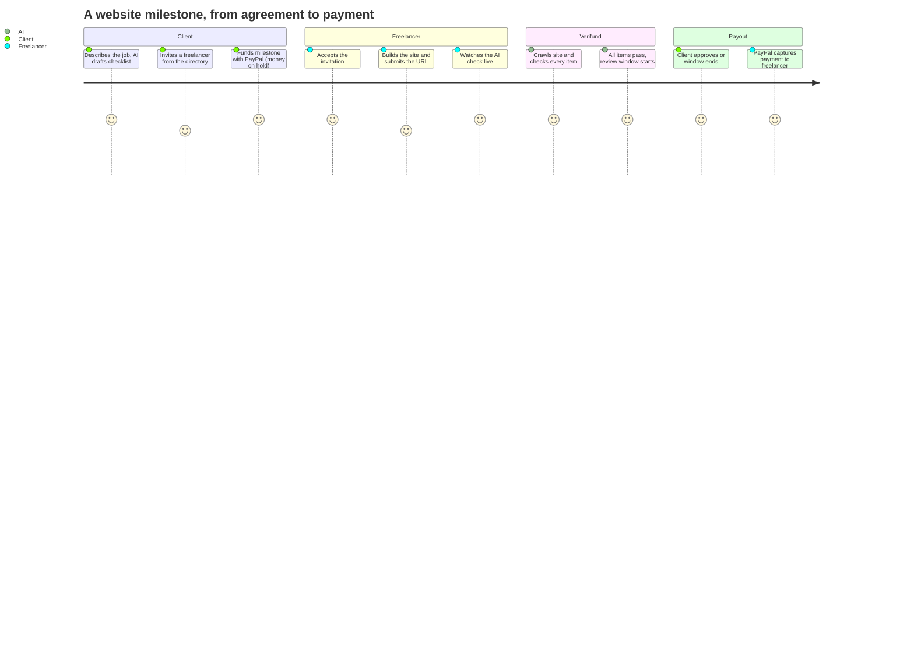
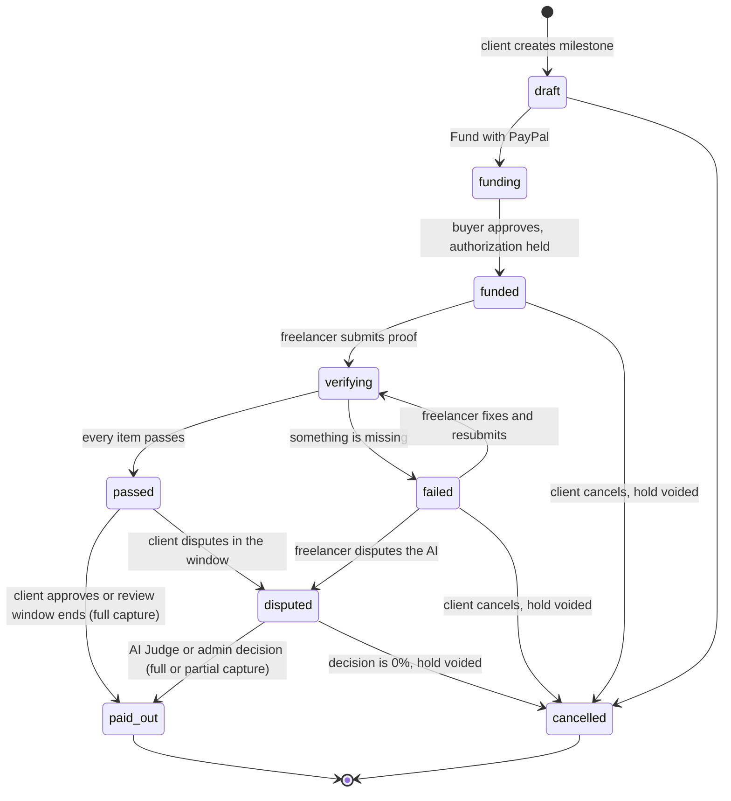
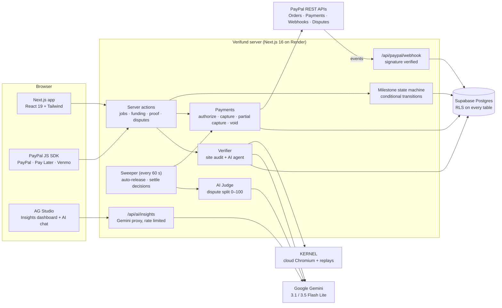
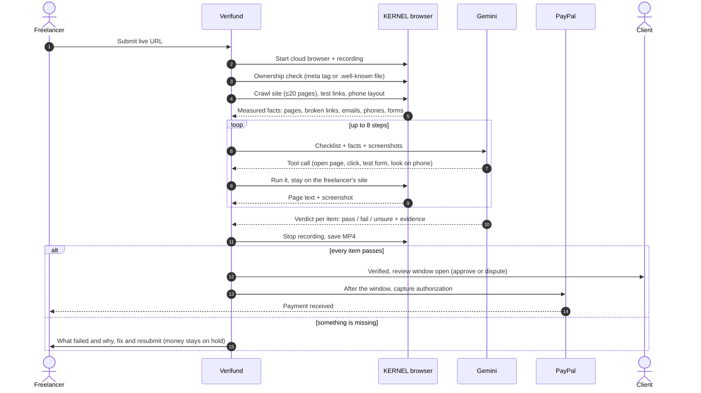

<div align="center">


# Verifund

**AI escrow for freelance work. The money is held by PayPal, AI checks the delivered work, and the freelancer is paid when it's done.**

[Live app](https://verifund-l83s.onrender.com) · [Demo sites](https://shantanushinde99.github.io/PayPal/demo-sites/) · Built for the [PayPal AI Hackathon](https://paypalaihackathon.devpost.com/)

`PayPal Orders · Authorizations · Partial Captures · Webhooks · Disputes · JS SDK (PayPal, Pay Later, Venmo)` · `Google Gemini` · `KERNEL cloud browsers` · `AG Studio`

</div>

---

## The problem

Paying a stranger for work you can't check yourself is a trust problem on both sides:

- **Clients** pay up front and hope the website, the repair or the design is actually delivered as agreed. If it isn't, getting money back is slow and painful.
- **Freelancers** deliver first and hope to be paid. Late payments, endless "small changes" and clients who disappear are a normal part of freelance life.
- **Today's escrow doesn't fix the core question, "is the work done?"** A person still has to compare the delivery against the agreement. That makes escrow slow, expensive and subjective, so it's rarely used for small jobs like a $300 website or a $80 paint job.

## The solution

Verifund turns "done" into something that can be checked, and lets PayPal hold the money until it is.

1. **Agree on a checklist.** The client describes the job. Gemini drafts milestones and a checklist of concrete requirements, and flags vague items like "looks nice". Both sides see exactly what the AI will check.
2. **Fund the milestone.** The client pays with PayPal, Pay Later or Venmo. It's a **PayPal authorization**, so the money is held but not taken.
3. **Deliver and submit proof.** The freelancer submits a live website URL, or before/after photos for physical work.
4. **AI verifies.** For websites, a real cloud browser (KERNEL) crawls the site, measures facts with code (pages, broken links, emails, phone numbers, forms, phone layout) and lets Gemini use the browser like a person: open pages, click, submit forms with test data. Every checklist item gets *pass / fail / unsure* with evidence.
5. **Get paid, with a safety net.** If every item passes, a review window starts (24 h by default). The client can approve early or dispute; otherwise PayPal captures the money to the freelancer automatically.
6. **Disputes are settled fairly.** An **AI Judge** reads the checklist, the evidence and both sides' statements, and proposes a split (for example 70% to the freelancer). Code turns that into a PayPal **partial capture**, and the rest goes back to the client. Either side can reject the decision and send it to a human admin.

The AI never touches money directly. It only produces verdicts and a 0–100 share. Code validates them and moves money through conditional state changes with idempotent PayPal requests.

## Who it's for

| Use case | Proof | What the AI checks |
|---|---|---|
| Small-business website | Live URL | Required pages exist, contact details are exact, the form actually submits, no broken links, works on phones, matches the client's reference design |
| Landing page / web fix | Live URL | The specific change is live (new section, fixed link, correct price) |
| Painting, repairs, cleaning | Before/after photos | Requested changes are visible, the area is finished and clean |
| Design delivery | Live URL + reference image | Layout, palette and sections match the agreed mockup |

## Impact

- **Freelancers get paid when the work is done**, not when the client gets around to it. The money is held by PayPal from day one, so "will I get paid?" is answered before work starts.
- **Clients only pay for verified work.** Money moves only when every agreed item passes, or when a dispute is decided.
- **Escrow becomes practical for small jobs.** Verification takes about two minutes and costs very little, so escrow makes sense for a $50 milestone, not just a $50,000 contract.
- **Fewer, faster disputes.** A shared checklist and a [Proof Report](#features) with screenshots and recordings replace "he said, she said". When there is disagreement, the AI Judge proposes a fair split in seconds, and a human handles only the escalated cases.

---

## User journey



### Milestone lifecycle



Every arrow is an atomic, conditional database update (`UPDATE … WHERE state = <from>`), so two actions can never both win. For example, "approve now" racing the auto-release, or a dispute arriving as the window closes.

---

## Architecture



### How a website check works



### Design decisions that keep money safe

| Risk | How Verifund handles it |
|---|---|
| The AI is wrong | Review window before any capture; disputes; the AI Judge only proposes a share; human escalation; a funded hold never moves without a passing verdict or a decision |
| AI output is malformed or manipulated | Verdicts and shares are validated in code (`0–100` integers, known checklist ids). Website text and dispute statements are treated as untrusted data, never instructions |
| Double payment | Deterministic `PayPal-Request-Id` on every money call, plus conditional state transitions |
| Freelancer submits someone else's site | Site ownership check: a per-freelancer HMAC code in a meta tag or `/.well-known/verifund.txt`, measured by code |
| The checker wanders off | The crawler and the AI's tools are locked to the submitted site; redirects to other domains are refused |
| Lost browser tab during payment | `CHECKOUT.ORDER.APPROVED` webhook finishes funding server-side |
| Buyer disputes on PayPal | `CUSTOMER.DISPUTE.*` webhook links it to the milestone, sends the Proof Report as evidence, or guides the freelancer to the Resolution Center |
| Shared free AI quota | Per-model rate limiter (requests per minute/day) with automatic fallback between two Gemini models; per-user limits on the AI chat |

---

## Features

**Escrow and payments (PayPal)**
- Orders with `intent=AUTHORIZE`. Money is held, not taken, until the work is verified.
- PayPal, **Pay Later** and **Venmo** buttons through the JS SDK. Venmo and Pay Later only appear when PayPal says the buyer is eligible. A redirect fallback is kept.
- Full capture, **partial capture** (`final_capture: true` returns the rest to the client) and void.
- **Webhooks** (signature-verified, each event stored once) for approvals, captures, voids, refunds and buyer disputes.
- **Disputes API**: automatic evidence from the Proof Report, with Resolution Center guidance as a fallback.
- Multi-currency (USD, EUR, GBP, CAD, AUD, JPY, with zero-decimal currencies handled). Google Pay-style payment history and a Wallet with live "Confirmed by PayPal" status.

**AI verification (Gemini + KERNEL)**
- An AI job planner turns a description into milestones and checklists. A checklist linter flags vague or unverifiable items before funding.
- A deep site audit in a real cloud browser covers up to 20 pages: broken links, exact contact details, forms and phone layout.
- An agentic checker: Gemini drives the browser (open, click, fill and submit forms with test data, resize to phone) and compares against an optional **reference design** image.
- Photo proof: a before/after comparison for physical work.
- **Watch the AI check your site**: every check is recorded by KERNEL and replayed in the app (visible only to the job's parties).
- A **Proof Report** per submission: per-item verdicts, evidence, screenshots, site map, links, contact details and recording. Printable as PDF.

**Trust and disputes**
- A review window after an AI pass (24 h, or 2 minutes in demo workspaces), with "Approve & pay now" or "Dispute".
- The **AI Judge** proposes a split, and the decision settles automatically unless rejected. An **admin** decides escalated cases.
- Site ownership verification for submitted websites.

**Platform**
- PayPal login and onboarding as client, freelancer or both, plus a freelancer directory with track records and job invitations.
- **Insights** (AG Studio): a dashboard of money in escrow, payments over time, checklist pass/fail by requirement and time to payment. It includes an **"Ask your data" AI assistant** (Gemini) that builds new charts from a sentence.
- **One-click judge demo**: each visitor gets a private workspace with a client and freelancers, switches sides with one button, and the data is deleted after 48 h.

---

## Sponsor tools

| Tool | Used for |
|---|---|
| **PayPal** | Orders (authorize), Authorizations (capture, partial capture, void), JS SDK buttons (PayPal, Pay Later, Venmo), Webhooks with signature verification, Disputes API evidence, Log in with PayPal |
| **Google Gemini** | Job planning, checklist lint, agentic website verification with tool calls, photo comparison, AI Judge, Insights chat (two Flash Lite models with automatic fallback) |
| **KERNEL** | Cloud Chromium for every website check (via Playwright over CDP), session recordings (MP4 replays) |
| **AG Studio (AG Grid)** | The Insights analytics dashboard and its AI agent, wired to Gemini through a custom LLM adapter and our own server route |

## Tech stack

Next.js 16 (App Router, server actions) · React 19 · TypeScript · Tailwind CSS 4 · Motion · Auth.js (PayPal OAuth + demo provider) · Drizzle ORM · PostgreSQL (Supabase, RLS) · Playwright-core · Vitest (150+ tests) · Render

## Project structure

```
src/
  app/                    pages, server actions and API routes
    jobs/[id]/            job page: funding buttons, proof, verdicts, disputes, replay
    jobs/[id]/report/     printable Proof Report
    insights/             AG Studio dashboard + Gemini adapter
    admin/disputes/       human decisions for escalated disputes
    api/paypal/           return URL and webhook
    api/replays/[id]/     check recordings (parties only)
    api/ai/insights/      Gemini proxy for the Insights chat
  lib/
    payments.ts           fund, settle (full / partial / void), cancel
    paypal.ts             PayPal REST client (idempotent request ids)
    milestone-state.ts    allowed state transitions
    disputes.ts           disputes and the AI Judge
    review-window.ts      auto-release sweeper
    webhooks.ts           PayPal event handling
    ownership.ts          site ownership codes
    verify/               site audit, AI website agent, photo check
  db/schema.ts            tables (Drizzle)
demo-sites/               sample sites for trying the checker (easy → hard)
scripts/                  local Postgres, webhook registration, migrations
```

---

## Try it

**Hosted:** open the [live app](https://verifund-l83s.onrender.com) and click **Try the demo**. You get a private client account with ready-made jobs. Fund one with the PayPal sandbox buyer shown in the yellow banner, switch to the freelancer side and submit a demo site, then watch the AI check it.

**Demo sites to submit** (from easy to hard):

| Site | URL | Notes |
|---|---|---|
| Bakery (broken) | `…/demo-sites/bakery-v1/` | Email typo, no contact form, broken link: should **fail** |
| Bakery (fixed) | `…/demo-sites/bakery-v2/` | Should **pass** the bakery checklist |
| Greenleaf Dental | `…/demo-sites/intermediate/` | 7 pages, validated booking form, pricing table |
| Northwind Travel | `…/demo-sites/hard-site/` | 19 pages in 3 levels, JS-built navigation, JSON-loaded tours with filters, 3-step booking, login, currency switcher |

Base URL: `https://shantanushinde99.github.io/PayPal`. Ready-to-paste checklists, including items that should fail, are in [`demo-sites/README.md`](demo-sites/README.md), and screenshots for the reference-design upload are in `demo-sites/screenshots/`.

## Run locally

Requirements: Node 24, a PayPal sandbox app, a Gemini API key and a KERNEL API key. Docker isn't needed: Postgres runs embedded.

```bash
npm install
cp .env.example .env    # fill in the values below
npm run db              # local Postgres on port 5433 (keep running)
npm run db:push         # create tables
npm run dev             # http://lvh.me:3000
```

| Variable | Purpose |
|---|---|
| `PAYPAL_CLIENT_ID`, `PAYPAL_CLIENT_SECRET` | Sandbox REST app |
| `PAYPAL_API_BASE`, `PAYPAL_WEB_BASE` | `https://api-m.sandbox.paypal.com`, `https://www.sandbox.paypal.com` |
| `PAYOUT_MODE` | `direct` (capture pays the freelancer, default) or `payouts` (capture to platform, then Payouts API with a 5% fee) |
| `PAYPAL_WEBHOOK_ID` | From `npx tsx --env-file=.env scripts/register-webhook.mts <public URL>` |
| `GEMINI_API_KEY`, `GEMINI_MODEL_PRIMARY`, `GEMINI_MODEL_FALLBACK` | e.g. `gemini-3.1-flash-lite`, `gemini-3.5-flash-lite` |
| `KERNEL_API_KEY` | Cloud browsers and recordings |
| `DATABASE_URL` | Postgres connection string |
| `AUTH_SECRET`, `APP_URL` | Session secret and public URL |
| `AG_STUDIO_LICENSE_KEY` | Optional; without it AG Studio shows a trial watermark |
| `REVIEW_WINDOW_MINUTES` | Optional; default 1440 (24 h), max 2880 |
| `DEMO_PAYOUT_EMAIL`, `DEMO_BUYER_EMAIL`, `DEMO_BUYER_PASSWORD` | Optional; enables the judge demo (sandbox accounts) |

Tests use a separate `pod_test` database: `npm test`.

## Limitations and next steps

- The sweeper and rate limits run in a single process; with several instances they'd move to a scheduled job and a shared store.
- Captures must happen within PayPal's 3-day honor period, which is why the review window is capped at 48 h; reauthorization for longer windows is next.
- Website checks are capped at 20 pages and 8 AI steps to fit the free Gemini tier.
- Sandbox only: live payments would add KYC, and AML and content policies for marketplaces.
- Next: a mobile app for photo proof, more proof types (GitHub repos, documents, app builds), and recurring milestones.

## License

[MIT](LICENSE)
