<div align="center">


# Verifund

**AI escrow for freelance work. The money is held by PayPal, AI checks the delivered work, and the freelancer is paid when it's done.**

[Live app](https://verifund-ckg3gxbeg0a7bzbp.indiasouthcentral-01.azurewebsites.net) · [Demo sites](https://shantanushinde99.github.io/verifund-demo-sites/) · Built for the [PayPal AI Hackathon](https://paypalaihackathon.devpost.com/)

`PayPal Orders · Authorizations · Partial Captures · Webhooks · Disputes · JS SDK (PayPal, Pay Later, Venmo)` · `Google Gemini` · `Mistral` · `KERNEL cloud browsers` · `AG Studio`

</div>

<p align="center">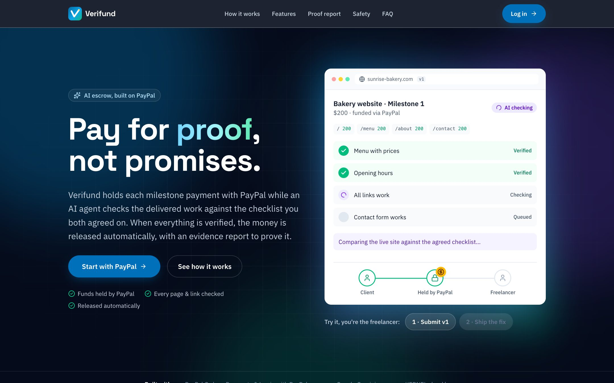</p>

---

## The problem

Paying a stranger for work you can't check yourself is a trust problem on both sides:

- **Clients** pay up front and hope the website, the repair or the design is actually delivered as agreed. If it isn't, getting money back is slow and painful.
- **Freelancers** deliver first and hope to be paid. Late payments, endless "small changes" and clients who disappear are a normal part of freelance life.
- **Today's escrow doesn't fix the core question, "is the work done?"** A person still has to compare the delivery against the agreement. That makes escrow slow, expensive and subjective, so it's rarely used for small jobs like a $300 website or a $80 paint job.

## The solution

Verifund turns "done" into something that can be checked, and lets PayPal hold the money until it is.

1. **Agree on what "done" means.** The client describes the job. Gemini drafts milestones and a checklist of concrete requirements, flags vague items like "looks nice", and adds a **quality baseline** to every live website (https, no placeholder text, no broken links or images, fits a phone). **"Did you forget anything?"** lists what clients usually assume is included; whatever the client doesn't tick is written down as **not included**. The client can also add **customer journeys** ("a customer can book a table for 4 on Friday"), their **domain**, and **handover items** (admin login, repo transfer).
2. **Approve the design first.** For visual work, the first milestone is a **design mockup** the client approves by eye, with an agreed number of **change rounds** (2 by default). The build is then checked against the approved design.
3. **Fund the milestone.** The client pays with PayPal, Pay Later or Venmo. It's a **PayPal authorization**, so the money is held but not taken.
4. **Build, with preview checks.** The freelancer can run a **preview check** on work in progress at any time; both sides see "4 of 7 done", and no money moves. New requests mid-job go to **"Included, or new work?"**: the AI compares them with the agreement, and new work becomes a **paid milestone** the freelancer accepts or declines.
5. **AI verifies.** The freelancer submits a live website, a public GitHub repository, or before/after photos. For websites, a real cloud browser (KERNEL) crawls the site, measures facts with code (pages, broken links, emails, phone numbers, forms, phone layout, https, placeholder text, the domain) and lets Gemini use the browser like a person: open pages, click, fill in fields, submit forms, and **perform each customer journey end to end**. Every checklist item gets *pass / fail / unsure* with evidence.
6. **The client confirms and pays.** A review window starts (24 h by default). The AI's test message carries a code, and the client confirms it **reached their inbox**; they also confirm each **handover item**. Approve, dispute (naming the unmet checklist item), or let the window end.
7. **Disputes are settled fairly.** An **AI Judge** reads the checklist, the evidence, what was agreed as not included, and both sides' statements, and proposes a split (for example 70% to the freelancer). Code turns that into a PayPal **partial capture**. Either side can reject the decision and send it to a human admin.
8. **Warranty.** For a live website, part of the payment (**25% by default**, for 7 or 14 days) stays authorized at PayPal after approval while Verifund reloads every page daily. If the site keeps working it's captured to the freelancer automatically; if a page is still broken at the end, it goes back to the client. Only the daily check can hold it back, never the client.

The AI never touches money directly. It only produces verdicts and a 0–100 share. Code validates them and moves money through conditional state changes with idempotent PayPal requests.

## Who it's for

| Use case | Proof | What the AI checks |
|---|---|---|
| Small-business website | Live URL | Required pages exist, contact details are exact, the form actually submits, no broken links, works on phones, matches the client's reference design |
| Landing page / web fix | Live URL | The specific change is live (new section, fixed link, correct price) |
| Painting, repairs, cleaning | Before/after photos | Requested changes are visible, the area is finished and clean |
| Design delivery | Design mockup, then live URL | The client approves the mockup within the agreed change rounds; the build must match it |
| Booking, ordering, sign-up flows | Live URL + customer journeys | The agent completes the journey like a customer and sees the confirmation |
| Code delivery | Public GitHub repository | Files, routes, tests and README steps read from the code |

## Impact

- **Freelancers get paid when the work is done**, not when the client gets around to it. The money is held by PayPal from day one, so "will I get paid?" is answered before work starts.
- **Clients only pay for verified work.** Money moves only when every agreed item passes, or when a dispute is decided.
- **Escrow becomes practical for small jobs.** Verification takes about two minutes and costs very little, so escrow makes sense for a $50 milestone, not just a $50,000 contract.
- **Fewer, faster disputes.** A shared checklist and a [Proof Report](#features) with screenshots and recordings replace "he said, she said". When there is disagreement, the AI Judge proposes a fair split in seconds, and a human handles only the escalated cases.

## Screenshots

Screenshots of the app running on the PayPal sandbox.

<table>
<tr>
<td width="50%"><b>1. Fund with PayPal, Pay Later or Venmo</b><br>The client sees exactly what the AI will check, then funds. The money is held by PayPal, not paid.<br>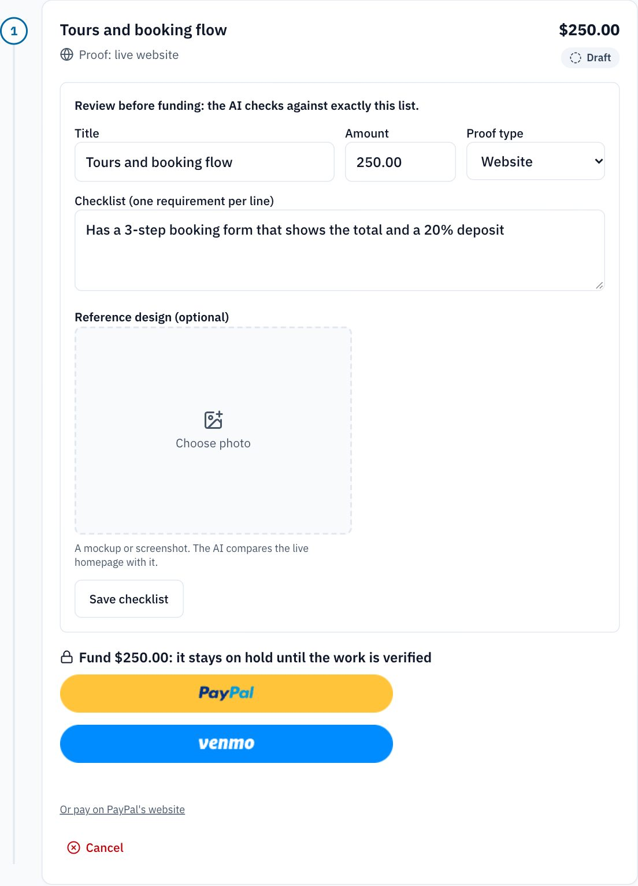</td>
<td width="50%"><b>2. Verified and paid</b><br>Every checklist item passed, so PayPal captured the payment to the freelancer. The capture is "Confirmed by PayPal".<br>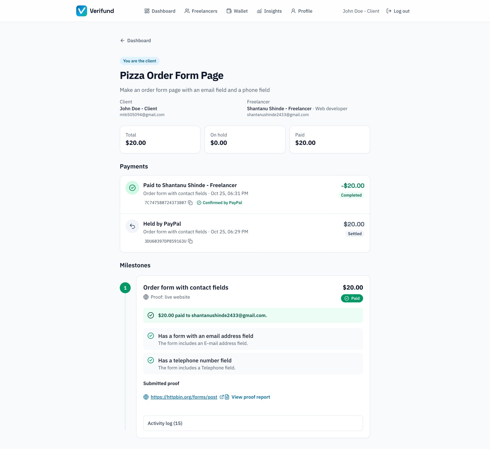</td>
</tr>
<tr>
<td><b>3. Proof Report</b><br>Evidence for each checklist item, with the page it was found on and a screenshot. It can be printed or saved as a PDF.<br>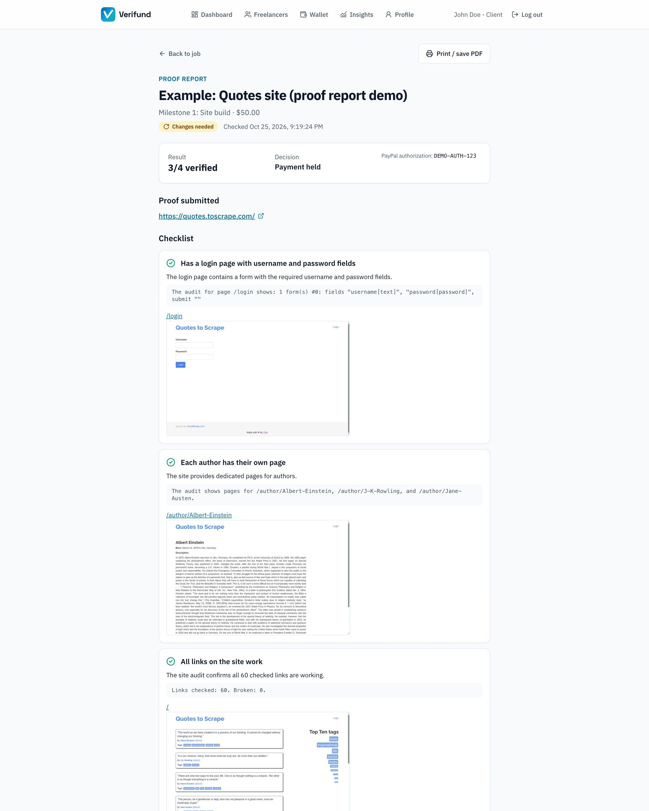</td>
<td><b>4. AI Judge resolves a dispute</b><br>Gemini weighed the checklist, the evidence and both statements and proposed 75% to the freelancer. That would be a partial capture of $300, with $100 going back to the client.<br>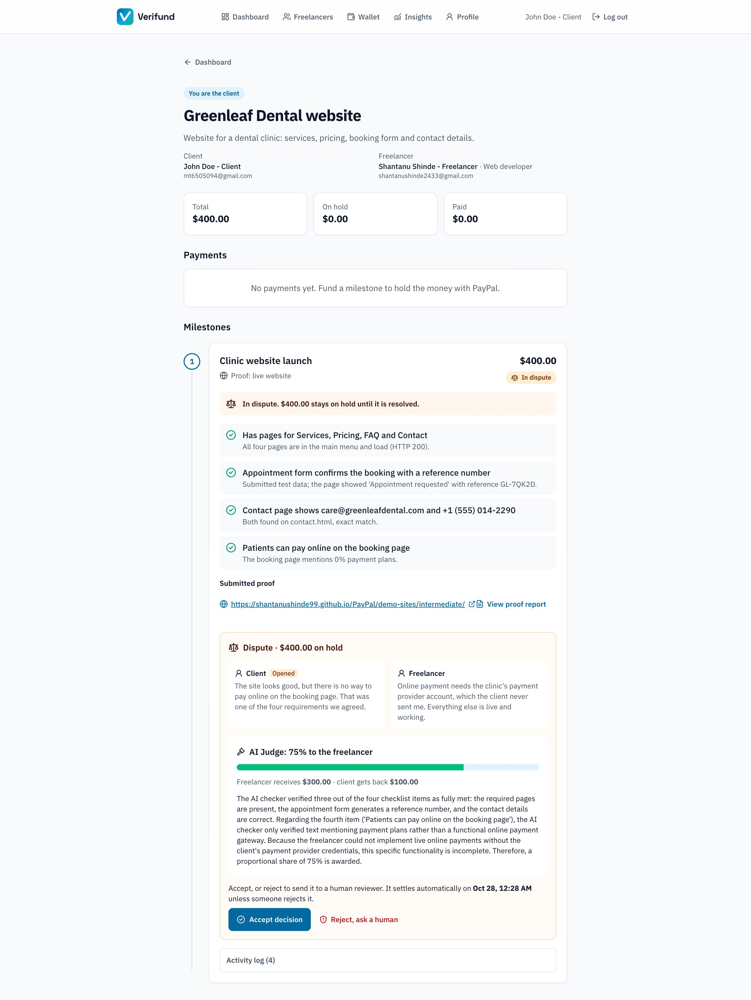</td>
</tr>
<tr>
<td><b>5. Wallet</b><br>Every PayPal movement with its transaction ID: held, paid, released.<br>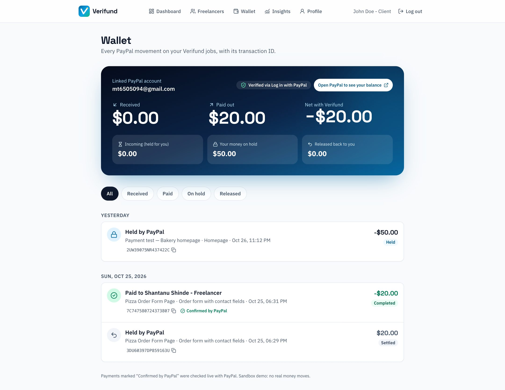</td>
<td><b>6. Insights (AG Studio + Gemini)</b><br>Money in escrow, payments over time, checklist results. Ask the AI assistant for new charts.<br>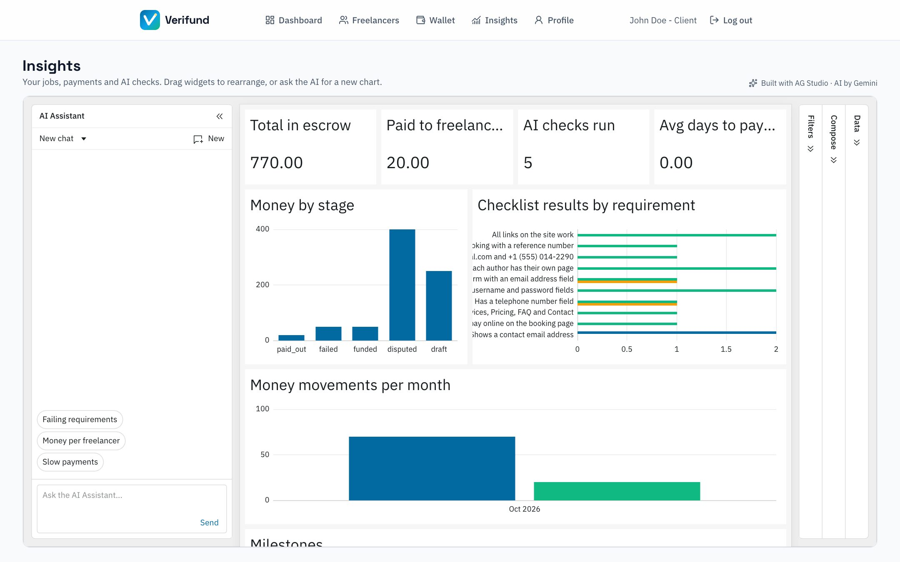</td>
</tr>
<tr>
<td><b>7. Dashboard</b><br>Jobs, holds and payouts at a glance.<br>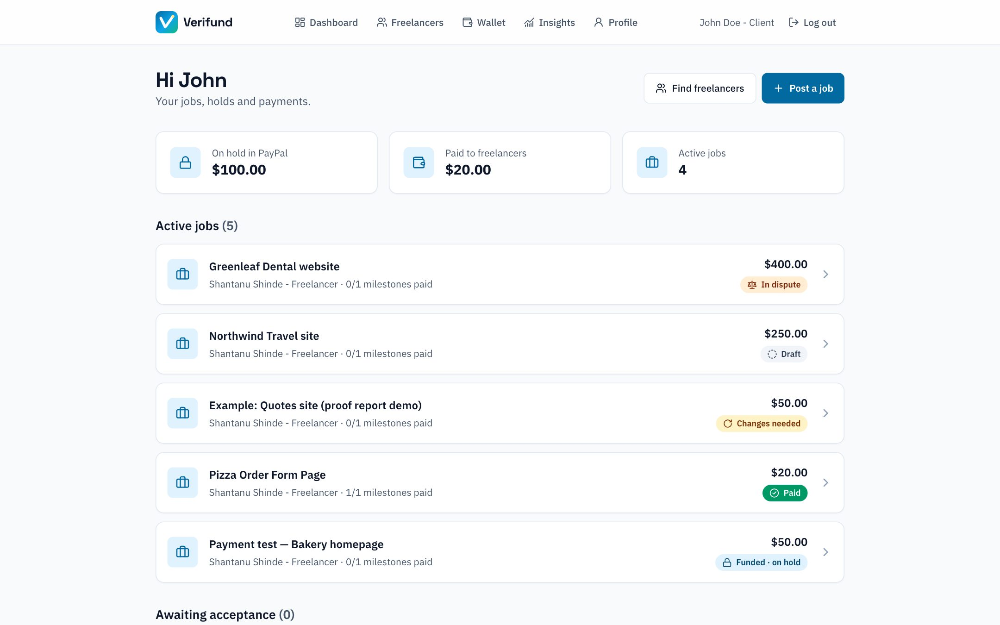</td>
<td><b>8. A check that failed</b><br>Missing items are explained, the money stays on hold, and the freelancer can fix the work and resubmit.<br>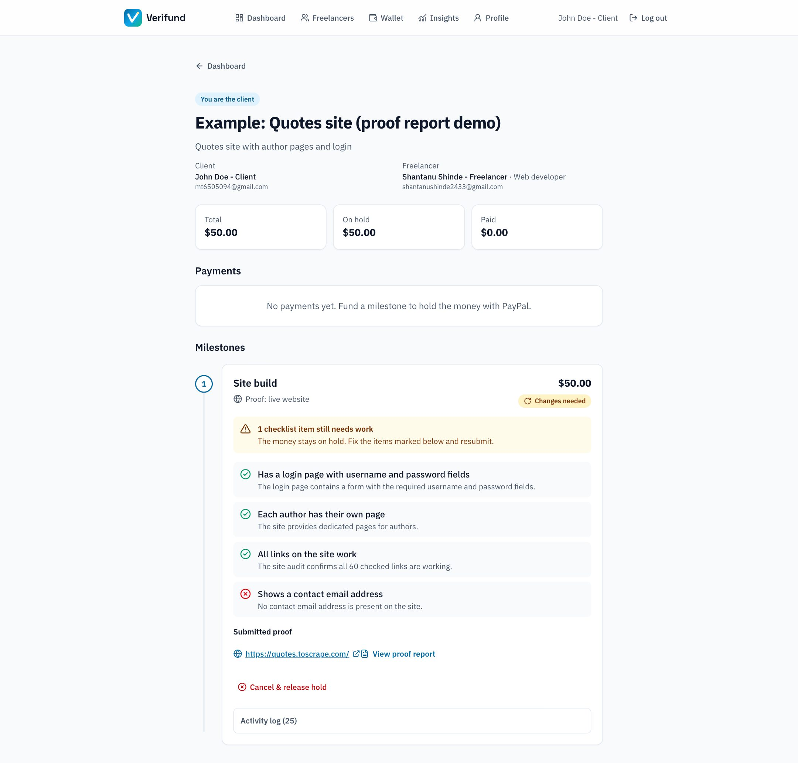</td>
</tr>
<tr>
<td><b>9. Freelancer directory</b><br>Profiles with skills and a verified track record.<br>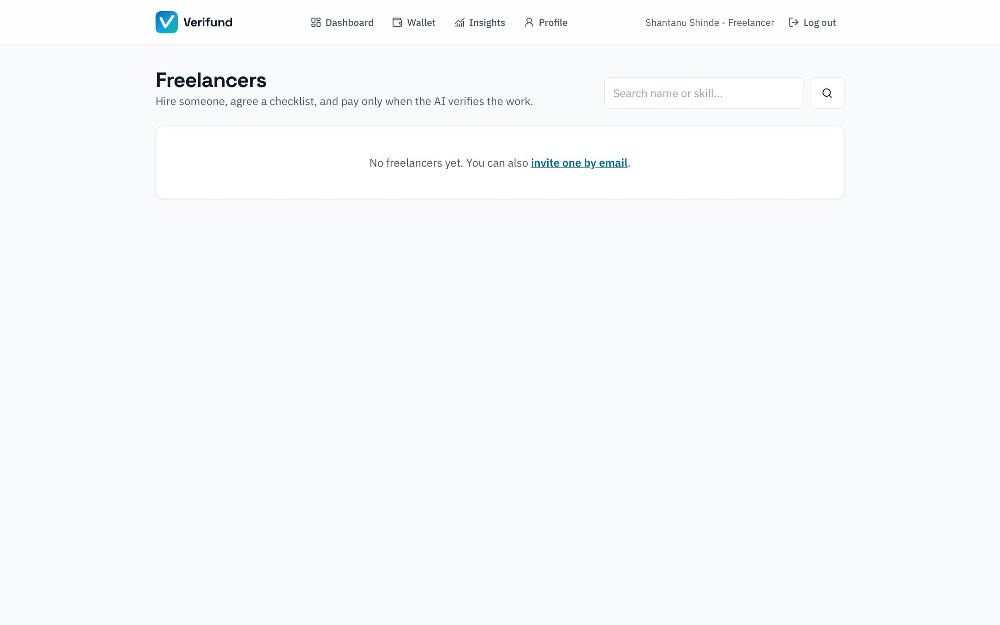</td>
<td><b>10. Demo site: Northwind Travel</b><br>The hardest test site: a Next.js + React app with client-side navigation, tours loaded in the browser and a 3-step booking wizard.<br>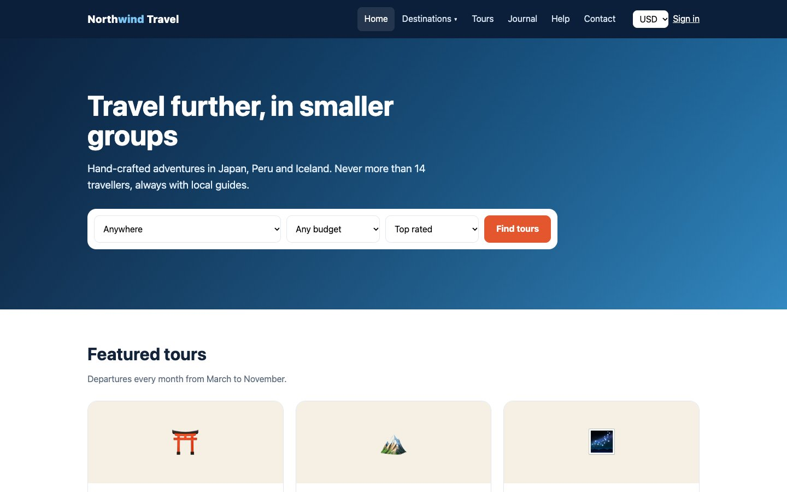</td>
</tr>
</table>

---

## User journey

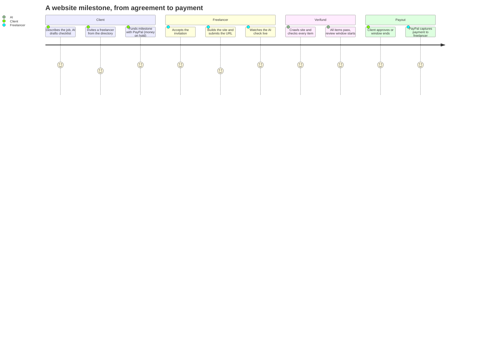

### Milestone lifecycle

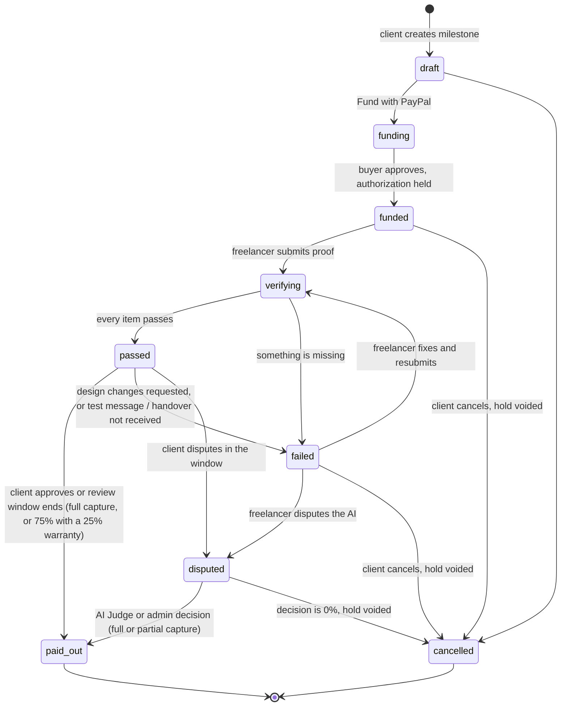

After `paid_out`, a warranty runs on its own: `holding` → `released` (the rest is captured) or `returned` (the rest is voided), decided by the daily site check.

Every arrow is an atomic, conditional database update (`UPDATE … WHERE state = <from>`), so two actions can never both win. For example, "approve now" racing the auto-release, or a dispute arriving as the window closes.

---

## Architecture

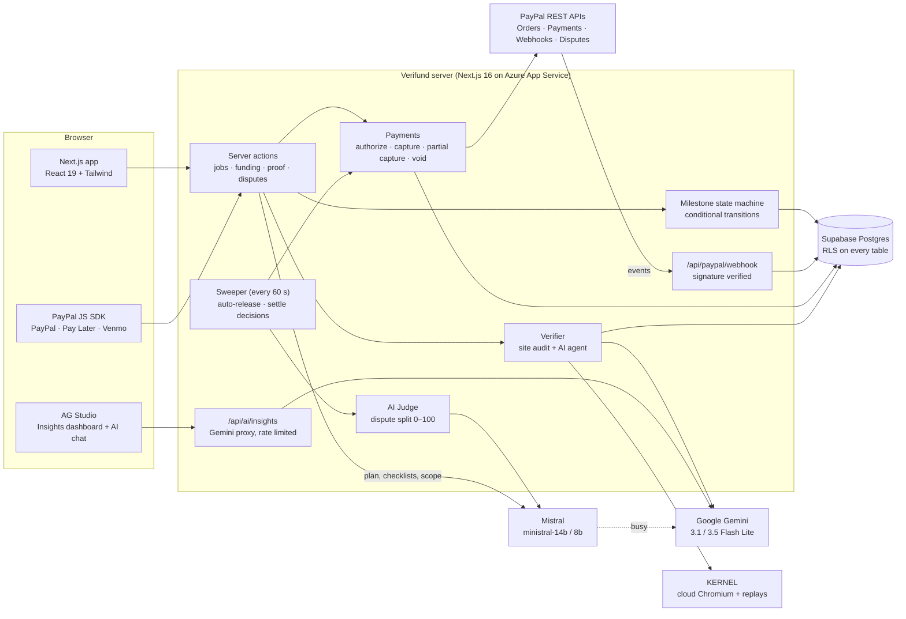

### How a website check works

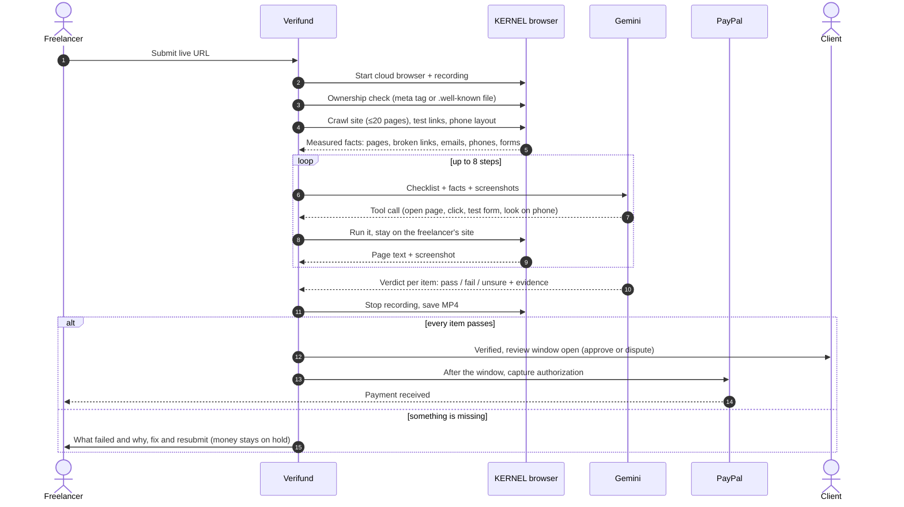

### Design decisions that keep money safe

| Risk | How Verifund handles it |
|---|---|
| The AI is wrong | Review window before any capture; disputes; the AI Judge only proposes a share; human escalation; a funded hold never moves without a passing verdict or a decision |
| AI output is malformed or manipulated | Verdicts and shares are validated in code (`0–100` integers, known checklist ids). Website text and dispute statements are treated as untrusted data, never instructions |
| Double payment | Deterministic `PayPal-Request-Id` on every money call, plus conditional state transitions |
| Freelancer submits someone else's site | Site ownership check: a per-freelancer HMAC code in a meta tag or `/.well-known/verifund.txt`, measured by code |
| The checker wanders off | The crawler and the AI's tools are locked to the submitted site; redirects to other domains are refused |
| Lost browser tab during payment | `CHECKOUT.ORDER.APPROVED` webhook finishes funding server-side |
| Buyer disputes on PayPal | `CUSTOMER.DISPUTE.*` webhook links it to the milestone, sends the Proof Report as evidence, or guides the freelancer to the Resolution Center |
| Shared free AI quota | Per-model rate limiter (requests per minute/day) with automatic fallback between two Gemini models; per-user limits on the AI chat |

---

## Features

**Escrow and payments (PayPal)**
- Orders with `intent=AUTHORIZE`. Money is held, not taken, until the work is verified.
- PayPal, **Pay Later** and **Venmo** buttons through the JS SDK. Venmo and Pay Later only appear when PayPal says the buyer is eligible. A redirect fallback is kept.
- Full capture, **partial capture** (`final_capture: true` returns the rest to the client) and void.
- **Webhooks** (signature-verified, each event stored once) for approvals, captures, voids, refunds and buyer disputes.
- **Disputes API**: automatic evidence from the Proof Report, with Resolution Center guidance as a fallback.
- Multi-currency (USD, EUR, GBP, CAD, AUD, JPY, with zero-decimal currencies handled). Google Pay-style payment history and a Wallet with live "Confirmed by PayPal" status.

**AI verification (Gemini + KERNEL)**
- An AI job planner turns a description into milestones and checklists. A checklist linter flags vague or unverifiable items before funding.
- A deep site audit in a real cloud browser covers up to 20 pages: broken links, exact contact details, forms and phone layout.
- An agentic checker: Gemini drives the browser (open, click, fill and submit forms with test data, resize to phone) and compares against an optional **reference design** image.
- Photo proof: a before/after comparison for physical work.
- **Watch the AI check your site**: every check is recorded by KERNEL and replayed in the app (visible only to the job's parties).
- A **Proof Report** per submission: per-item verdicts, evidence, screenshots, site map, links, contact details and recording. Printable as PDF.

**Trust and disputes**
- A review window after an AI pass (24 h, or 2 minutes in demo workspaces), with "Approve & pay now" or "Dispute".
- The **AI Judge** proposes a split, and the decision settles automatically unless rejected. An **admin** decides escalated cases.
- Site ownership verification for submitted websites and repositories.
- **Design approval first**: visual jobs start with a mockup the client approves, with a limited number of change rounds agreed up front; the build is then checked against the approved design.
- Disputes must name the checklist item that isn't met, and the AI Judge ignores taste outside the checklist or the approved design.

**Protecting both sides (agreeing on "done", then keeping it)**
- **"Did you forget anything?"**: before funding, Gemini lists what clients usually expect for the job; ticked items join the checklist, the rest is recorded as **not included** and shown to the freelancer (and the AI Judge).
- **Quality baseline** on every live website: https, no placeholder text, no broken links or images, phone fit; all measured by code.
- **Customer journeys**: plain-language tasks the agent performs step by step with a `fill_field` tool, passing only when it completes them.
- **Inbox check**: every test message carries a code (`VF-XXXX`); the client confirms it arrived. "No" sends the work back (disputable).
- **Preview checks**: the same AI check on work in progress, with no state or money change (limited per milestone).
- **Included, or new work?**: either side asks; the AI answers against the agreed checklists. New work becomes a milestone the freelancer must accept before it can be funded.
- **Handover check**: the client's domain is checked by code; handover items (logins, transferred repo) are confirmed by the client.
- **Warranty holdback**: a share of each live-website milestone stays authorized after release (PayPal capture with `final_capture: false`), the site is checked daily, and the rest is captured or voided at the end.

**Platform**
- PayPal login and onboarding as client, freelancer or both, plus a freelancer directory with track records and job invitations.
- **Insights** (AG Studio): a dashboard of money in escrow, payments over time, checklist pass/fail by requirement and time to payment. It includes an **"Ask your data" AI assistant** (Gemini) that builds new charts from a sentence.
- **One-click judge demo**: each visitor gets a private workspace with a client and freelancers, switches sides with one button, and the data is deleted after 48 h.

---

## Sponsor tools

| Tool | Used for |
|---|---|
| **PayPal** | Orders (authorize), Authorizations (capture, partial capture, void), JS SDK buttons (PayPal, Pay Later, Venmo), Webhooks with signature verification, Disputes API evidence, Log in with PayPal |
| **Google Gemini** | The agentic website checker (tool calls + screenshots + reference design), photo comparison, the GitHub repo checker and the Insights chat (two Flash Lite models with automatic fallback); backup for every Mistral task |
| **Mistral** | The text tasks: job planning, checklist checks, "did you forget anything?", "included or new work?", the AI Judge and profile import (`ministral-14b`, then `ministral-8b`), so Gemini's quota is kept for the browsing agent |
| **KERNEL** | Cloud Chromium for every website check (via Playwright over CDP), session recordings (MP4 replays) |
| **AG Studio (AG Grid)** | The Insights analytics dashboard and its AI agent, wired to Gemini through a custom LLM adapter and our own server route |

## Tech stack

Next.js 16 (App Router, server actions) · React 19 · TypeScript · Tailwind CSS 4 · Motion · Auth.js (PayPal OAuth + demo provider) · Drizzle ORM · PostgreSQL (Supabase, RLS) · Playwright-core · Vitest (200+ tests) · Azure App Service

## Project structure

```
src/
  app/                    pages, server actions and API routes
    jobs/[id]/            job page: funding buttons, proof, verdicts, disputes, replay
    jobs/[id]/report/     printable Proof Report
    insights/             AG Studio dashboard + Gemini adapter
    admin/disputes/       human decisions for escalated disputes
    api/paypal/           return URL and webhook
    api/replays/[id]/     check recordings (parties only)
    api/ai/insights/      Gemini proxy for the Insights chat
  lib/
    payments.ts           fund, settle (full / partial / void), cancel
    paypal.ts             PayPal REST client (idempotent request ids)
    milestone-state.ts    allowed state transitions
    disputes.ts           disputes and the AI Judge
    expectations.ts       "did you forget anything?" and the quality baseline
    design-review.ts      design milestones and change rounds
    scope.ts              "included, or new work?" and proposed milestones
    inbox-check.ts        the coded test message the client confirms
    handover.ts           domain check and handover confirmations
    warranty.ts           daily site checks and the end of the warranty
    review-window.ts      auto-release sweeper
    webhooks.ts           PayPal event handling
    ownership.ts          site ownership codes
    verify/               site audit, AI website agent, photo check
  db/schema.ts            tables (Drizzle)
demo-sites/               sample sites for trying the checker (easy → hard)
scripts/                  local Postgres, webhook registration, migrations
```

---

## Try it

**Hosted:** open the [live app](https://verifund-ckg3gxbeg0a7bzbp.indiasouthcentral-01.azurewebsites.net) and click **Try the live demo**. You get a private client account (Leon Kennedy) with ready-made jobs and freelancers. Nothing to install, no sign-up, and the workspace is deleted after 48 hours.

A full tour in about 10 minutes:

1. **Post a job** (Dashboard → Post a job). Describe a website, choose a freelancer from the directory, keep the **warranty** at 25% / 7 days. The AI drafts a **design milestone** and a **build** with the quality baseline.
2. On the build, click **Find what's missing**, tick what you want, and add a **customer journey** and a **handover item** (for example "Admin login for the website"). Save.
3. Click **Switch to the freelancer side** in the yellow banner and **Accept job**. Switch back.
4. **Fund** the design milestone. Use the **PayPal sandbox buyer email and password shown in the yellow banner** (there are copy buttons).
5. As the freelancer, upload a mockup (any screenshot). As the client, **Ask for changes**, then approve it after the freelancer resends it.
6. Fund the build. As the freelancer, run a **Preview check** on `bakery-v1` (broken) and watch it report what's missing, with no money moving.
7. As the client, ask **"Included, or new work?"**, for example "Can customers order cakes online?".
8. As the freelancer, submit `bakery-v2` (fixed) for the AI check and open the activity log to watch it live, including the customer journey.
9. As the client, answer the **inbox** and **handover** questions, then **Approve & pay**: 75% is paid and 25% is held as the warranty. In demo workspaces the review window is 2 minutes and the warranty 10 minutes, so you can watch it release.
10. Open **View proof report**, **Watch the AI check this site**, the **Wallet** and **Insights**.

**Demo sites to submit** (from easy to hard):

| Site | URL | Notes |
|---|---|---|
| Bakery (broken) | [`bakery-v1/`](https://shantanushinde99.github.io/verifund-demo-sites/bakery-v1/) | Email typo, no contact form, broken link: should **fail** |
| Bakery (fixed) | [`bakery-v2/`](https://shantanushinde99.github.io/verifund-demo-sites/bakery-v2/) | Should **pass** the bakery checklist |
| Greenleaf Dental | [`intermediate/`](https://shantanushinde99.github.io/verifund-demo-sites/intermediate/) | 7 pages, validated booking form, pricing table |
| Northwind Travel | [`hard-site/`](https://shantanushinde99.github.io/verifund-demo-sites/hard-site/) | A Next.js + React app: client-side navigation, tours loaded in the browser with filters, 3-step React booking wizard, login, currency switcher, cookie bar, pop-up |

All four are listed at [shantanushinde99.github.io/verifund-demo-sites](https://shantanushinde99.github.io/verifund-demo-sites/). Ready-to-paste checklists, including items that should fail, are in [`demo-sites/README.md`](demo-sites/README.md), and screenshots for the reference-design upload are in `demo-sites/screenshots/`.

## Run locally

This takes about 20 minutes, most of it creating the free accounts. Everything runs on your machine except PayPal (sandbox), Gemini and KERNEL. Docker isn't needed: Postgres runs embedded.

### 1. What you need

| Tool | Version | Check with |
|---|---|---|
| Node.js | 24.x (the project requires `>=24 <25`) | `node -v` |
| npm | comes with Node | `npm -v` |
| Git | any recent | `git --version` |
| Google Chrome | any recent (used by the local test scripts) | |

Free accounts: a **PayPal Developer** account, a **Google AI Studio** account (Gemini) and a **KERNEL** account. A **Mistral** account is optional.

### 2. Get the code

```bash
git clone https://github.com/shantanushinde99/PayPal.git verifund
cd verifund
npm install
cp .env.example .env
```

### 3. Create a PayPal sandbox app

1. Log in at [developer.paypal.com](https://developer.paypal.com) and open **Apps & Credentials**. Make sure the **Sandbox** toggle is on.
2. Click **Create App** (type **Merchant**). Copy the **Client ID** and **Secret** into `.env` as `PAYPAL_CLIENT_ID` and `PAYPAL_CLIENT_SECRET`.
3. In the app's settings, enable **Log in with PayPal**. Add the return URL `http://lvh.me:3000/api/auth/callback/paypal`, and under advanced options tick **Email address** and **Full name**.
4. Open **Sandbox accounts** (Testing tools). PayPal creates a **Personal** (buyer) and a **Business** (seller) account for you. Note the buyer's email and password (click the account, then **View/Edit account**): you'll use them to approve payments.
5. Leave `PAYPAL_API_BASE`, `PAYPAL_WEB_BASE` and `PAYOUT_MODE=direct` as they are in `.env.example`.

### 4. Get a Gemini API key

1. Open [aistudio.google.com](https://aistudio.google.com), sign in, and click **Get API key → Create API key**.
2. Put it in `.env` as `GEMINI_API_KEY`. Keep the two model names from `.env.example` (the app switches to the second model when the first is busy or out of quota).

### 5. Get a Mistral API key (optional)

1. Sign up at [console.mistral.ai](https://console.mistral.ai), choose the free **Experiment** plan, and create an API key under **API Keys**.
2. Put it in `.env` as `MISTRAL_API_KEY`. Planning, checklist checks, the AI Judge and the other text tasks then run on Mistral (`ministral-14b`, then `ministral-8b`), and Gemini is kept for the website agent. Without it, everything runs on Gemini.

### 6. Get a KERNEL API key

1. Sign up at [onkernel.com](https://onkernel.com) and create an API key in the dashboard.
2. Put it in `.env` as `KERNEL_API_KEY`. Website checks, previews and recordings run in KERNEL's cloud browsers.

### 7. Finish `.env`

```bash
openssl rand -base64 32     # paste the output as AUTH_SECRET
```

Keep `DATABASE_URL`, `APP_URL`, `AUTH_URL` and `AUTH_TRUST_HOST` as they are in `.env.example`. Use **`lvh.me`**, not `localhost`: it points to your own machine, and PayPal accepts it as a return URL.

Optional:
- **Judge demo** ("Try the live demo"): set `DEMO_PAYOUT_EMAIL` to your sandbox **Business** email and `DEMO_BUYER_EMAIL` / `DEMO_BUYER_PASSWORD` to the sandbox **Personal** account. Without them the demo button is hidden.
- `GITHUB_READ_TOKEN`: a read-only GitHub token for checking repositories (5,000 API calls an hour instead of 60).
- `AG_STUDIO_LICENSE_KEY`: removes the AG Studio trial watermark on Insights.
- `REVIEW_WINDOW_MINUTES`: how long the client has to approve or dispute (default 1440 = 24 h, max 2880).

### 8. Start the database (terminal 1)

```bash
npm run db
```

This downloads and starts a real PostgreSQL 17 on port **5433**, with a `pod` database for the app and a `pod_test` database for tests. Data is kept in `.data/pg`. **Leave this terminal open**: the app needs it running.

### 9. Create the tables (terminal 2)

```bash
npm run db:push          # the app database
npm run db:push:test     # the test database (only needed for npm test)
```

### 10. Start the app

```bash
npm run dev
```

Open **http://lvh.me:3000**. Click **Try the live demo** (if you set the demo variables) or **Start with PayPal** and log in with a sandbox account. When you fund a milestone, approve the payment with the sandbox **buyer** email and password.

### 11. Run the tests

```bash
npm test                 # 200+ tests; needs the database from step 8
npx tsc --noEmit         # type check
npm run lint
```

### 12. PayPal webhooks (optional locally, needed when hosted)

Webhooks confirm captures and pick up buyer disputes. PayPal can't reach `lvh.me`, so register them for a public URL (your hosted app, or a tunnel such as ngrok):

```bash
npx tsx --env-file=.env scripts/register-webhook.mts https://your-public-url
```

Put the printed ID in `.env` (and your host's settings) as `PAYPAL_WEBHOOK_ID`.

### 13. Deploy

Any Node 24 host works; the live demo runs on **Azure App Service** (Linux, Node 24) with **Supabase Postgres**, deployed by the GitHub Actions workflow in `.github/workflows/main_verifund.yml`.

1. Create a Postgres database and set its connection string as `DATABASE_URL` (for Supabase, use the pooler URL).
2. Create the tables there: `DATABASE_URL=<your url> npx drizzle-kit push`. On an existing database, run the files in `scripts/migrations/` in date order instead (they only add columns and tables, and are safe to re-run).
3. Set every variable from `.env` in the host's settings, with `APP_URL` and `AUTH_URL` set to your public URL.
4. Add `<your URL>/api/auth/callback/paypal` as a return URL in the PayPal app, and register the webhook (step 12).
5. Build with `npm ci && npm run build`, start with `npm start` (or `node node_modules/next/dist/bin/next start`).

### Troubleshooting

| Problem | Fix |
|---|---|
| `ECONNREFUSED ... 5433` | The database isn't running: start `npm run db` in its own terminal. |
| "The AI is busy right now" | Every model was busy or out of quota at once. Wait a minute and try again; the app already switches between the Mistral and Gemini models. |
| PayPal login says the redirect URL doesn't match | Add `http://lvh.me:3000/api/auth/callback/paypal` to the app's Log in with PayPal settings, and open the app at `lvh.me`, not `localhost`. |
| "Try the live demo" is missing | Set `DEMO_PAYOUT_EMAIL` (and the buyer variables) and restart `npm run dev`. |
| A website check fails before checking anything | Check `KERNEL_API_KEY`, and that the site is public and loads in a normal browser. |
| Tests fail with a missing column | Run `npm run db:push:test` again after pulling new code. |

## Limitations and next steps

- The sweeper and rate limits run in a single process; with several instances they'd move to a scheduled job and a shared store.
- PayPal guarantees a held authorization for 3 days and keeps it for 29: the review window is capped at 48 h and the warranty at 14 days to stay inside that; reauthorization for longer windows is next.
- The warranty monitor checks that every page still loads; it doesn't re-run journeys or forms daily yet.
- Website checks are capped at 20 pages and 8 AI steps to fit the free Gemini tier.
- Sandbox only: live payments would add KYC, and AML and content policies for marketplaces.
- Next: a mobile app for photo proof, more proof types (documents, app builds), and recurring milestones.

## License

[MIT](LICENSE)
